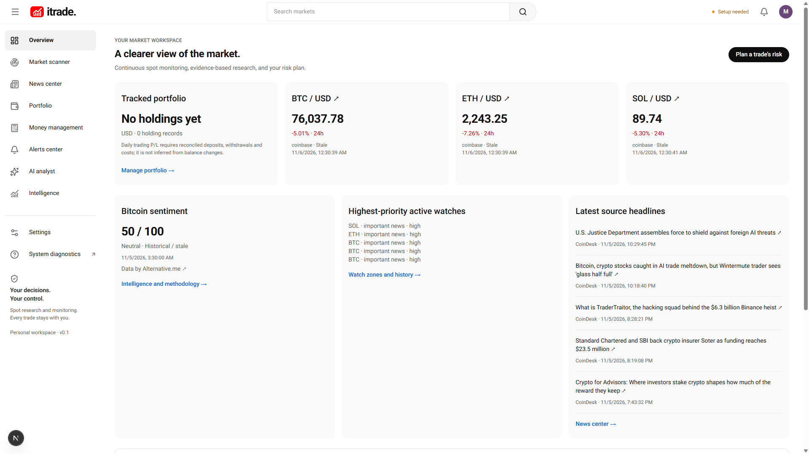
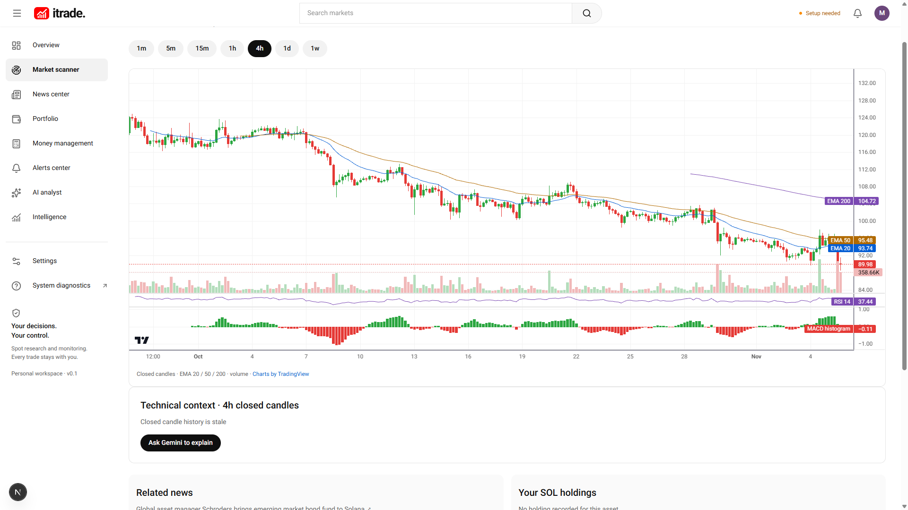
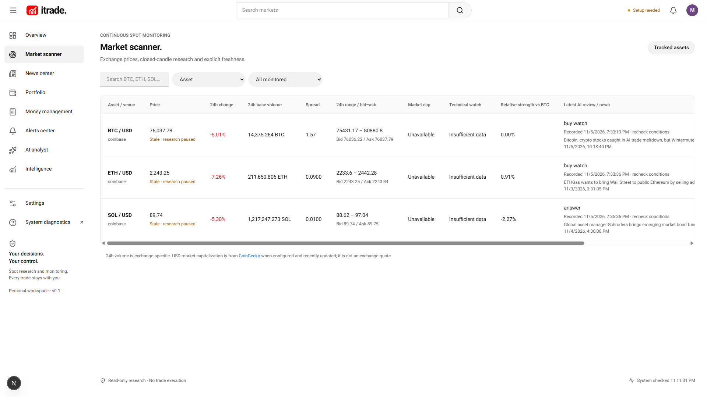
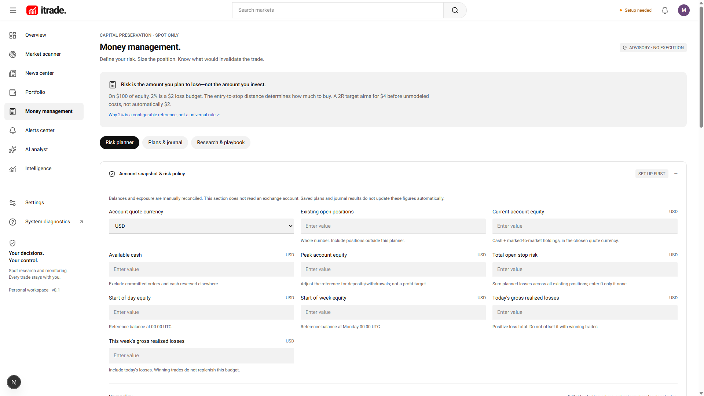
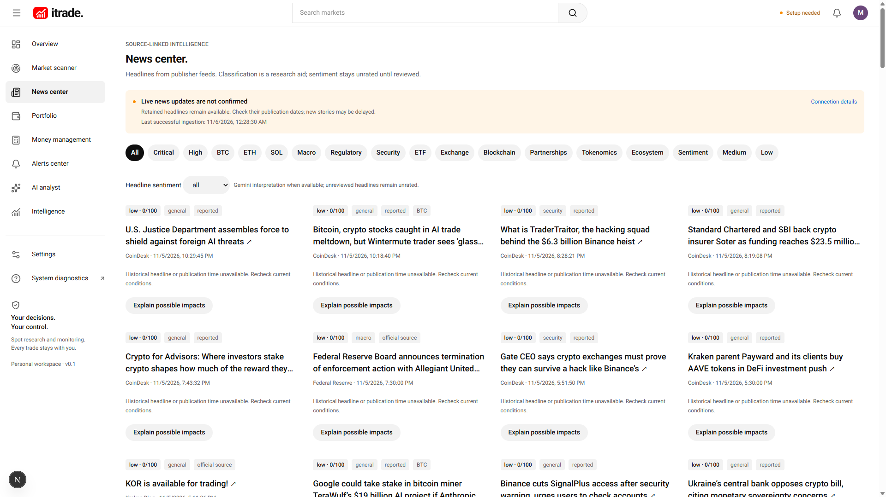

# ITrade

A personal, read-only crypto spot research copilot with an independent background worker. Market charts, news, Gemini analysis and chat, technical scanning, portfolio adapters, alerts, institutional analytics and Money Management are implemented. No order placement, leverage, transaction signing or wallet transfers exist.

**Initial M00–M10 implementation and local verification are complete; account/device/host activation remains.** Coinbase and Gemini have succeeded live. Private wallet/exchange syncing, device push and licensed institutional data need user configuration and acceptance checks. See the [milestone ledger](docs/roadmap.md) and [verification record](docs/verification.md) for exact coverage and remaining product limits.

## Overview & Screenshots

| Overview Workspace | Asset Research (SOL/USD) |
| :---: | :---: |
|  |  |

| Market Scanner | Money Management & Risk Sizing |
| :---: | :---: |
|  |  |

| Source-Linked Intelligence & News Center |
| :---: |
|  |

## Run locally

Use Node.js 24, npm and Docker Desktop with the Linux engine running. Preserve an existing `.env`.

```powershell
npm ci
if (!(Test-Path .env)) { Copy-Item .env.example .env }
npm run infra:up
npm run db:migrate
npm run dev
```

In a separate terminal run `npm run worker`. Open [ITrade](http://127.0.0.1:3000). The worker continues when the browser closes, while the computer and worker process remain running. Settings select venue, assets, timeframe, news interval, Gemini model/budget/intensity and notifications. Restart both processes after changing environment variables.

For a local production build stop the development web process, run `npm run build`, then `npm start`. Keep the worker running separately. Do not build while a production server uses the same `.next` directory.

Public markets and RSS require no account keys. Gemini uses a server-only key. Optional integrations clearly report missing configuration. Use the same `APP_ORIGIN` in browser and server. Remote deployment requires HTTPS and password authentication; deployment files are templates, not evidence of an operating hosted service.

## Money Management

[Open Money Management](http://127.0.0.1:3000/money-management). Save a reconciled account snapshot and enter a spot-long entry, stop and target. The calculator sizes from account risk and stop distance, including fees/slippage, quantity increments, cash, allocation, total/group open risk, loss limits and drawdown. It provides cost-adjusted R targets, loss-streak scenarios, saved plans and a manual P/L journal.

Risking 2% means a planned $2 loss on a $100 account at the stop, subject to costs and execution; it does not mean buying $2 of an asset or guaranteeing a $2 profit. The live Coinbase price/closed-candle ATR reference can inform a hypothetical stop distance. Neither ATR nor risk percentage establishes a profitable entry. Defaults are editable examples. Saved plans do not reserve capital; the journal does not automatically reconcile equity. See [research and calculation limits](docs/money-management.md).

## Verify

```powershell
npm run typecheck
npm test
npm run test:integration
npm run build
npm run check:secrets
npm run check:readiness
npm run backup:verify
# With the local web server running:
npm run test:routes
npm run test:load
node tests/api-live.mjs
node tests/risk-api-live.mjs
```

Integration tests use a disposable PostgreSQL database and Redis database 15; reserve that Redis database for tests. Backups require `BACKUP_ENCRYPTION_KEY`; verification restores only to an isolated scratch database. The local app uses Redis database 0. No sample holdings or live prices are seeded.

## Project map

| Directory      | Purpose                                                    |
| -------------- | ---------------------------------------------------------- |
| src/app        | Pages, REST and SSE                                        |
| src/components | Dashboard, charts and editors                              |
| src/domain     | Deterministic calculations and validation                  |
| src/server     | Providers, persistence, AI context and secrets             |
| src/worker     | Independent monitoring, queues and recovery                |
| db/migrations  | Checksummed transactional migrations                       |
| scripts        | Migration, backup/restore, retention and secret checks     |
| tests          | Unit, infrastructure, provider simulations and route tests |

## Documentation

- [Architecture and original inspection](docs/architecture.md)
- [Milestones and remaining acceptance](docs/roadmap.md)
- [Database implementation](docs/database.md)
- [Providers and configuration](docs/providers.md)
- [Operations, recovery and deployment](docs/operations.md)
- [Verification evidence](docs/verification.md)
- [Money Management research](docs/money-management.md)
