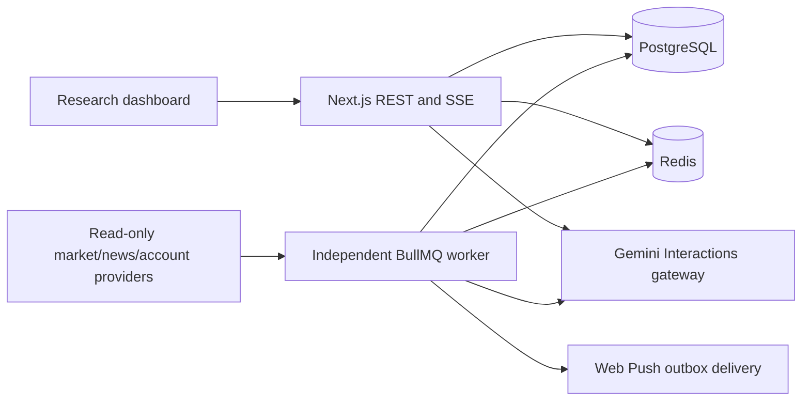

# ITrade architecture

Updated 2026-11-03.

## Initial inspection

The repository inspected on 2026-11-02 contained only .git, no commits, source or existing application stack. Architecture and dependency choices were documented before M01. No commits or pushes have been authorized or performed.

## Current implementation

One TypeScript repository runs a Next.js App Router web/API process and a separate BullMQ worker. PostgreSQL is the durable source of truth; Redis supplies live snapshots, queues, locks, throttles and heartbeat state. Parameterized SQL through pg and numbered checksum-protected migrations avoid an unnecessary ORM layer. Zod validates inputs/provider responses/AI contracts. Monetary calculations use decimal.js; on-chain scaling uses BigInt. Vitest tests deterministic rules and real disposable PostgreSQL/Redis integrations.



Services reside in src/server with pure contracts/calculations in src/domain. Browser components do not import credentials or infrastructure clients. The worker owns continuous WebSocket monitoring and periodic REST recovery, news, portfolio, scanner, alert and intelligence jobs. Global queue concurrency is one per service; use a single worker instance because the streaming loop is process-local.

## Evidence and controls

Validated market event/receipt timestamps and quote currency accompany data throughout the app. Closed/gap-free candles feed deterministic indicators and scanner events. Alert records preserve evidence and lifecycle history. Freshness gates block fresh-looking watches from stale data. USD and USDT remain distinct; unknown portfolio and institutional values are never silently zero.

Gemini uses the official SDK Interactions API, configurable model, strict structured output and bounded server-selected read-only context. PostgreSQL reserves every provider attempt against an atomic UTC-day request budget. Redis locks identical in-flight requests; stored input hashes cache eligible analyses. One 503 retry is separately budgeted; SDK retries are disabled. Source text is untrusted data, and responses cannot execute tools, orders or wallet operations.

News retains publisher headline/link metadata, canonicalizes duplicates and conservatively groups near-identical headlines. Classification and AI interpretation remain distinct from independent confirmation. See providers.md for actual sources and limits.

Portfolio adapters read public addresses or narrowly permitted Kraken keys. AES-GCM encrypts stored credentials and push-subscription payloads; encryption keys remain outside the database. No signing material, seed phrase or transaction capability is requested.

## Web and deployment boundary

The local web script binds to loopback; PostgreSQL and Redis development ports bind to loopback. Host/origin validation protects mutations, Redis enforces quotas, and a signed expiring HttpOnly/SameSite session supports password login. Non-loopback requests require HTTPS and authentication. Production Compose/Caddy templates are included, but no public deployment or external TLS acceptance has occurred. The product remains single-user: a login protects one shared personal workspace, not tenant-isolated accounts.

The UI now uses the supplied Red Broadcast system: white surfaces, Roboto fonts, restrained red/live accents and compact research layouts. It renders actual data, unavailable states and clear provenance. Health separates infrastructure liveness from individual provider freshness.

## Directory map

```text
src/app/          pages, REST/SSE routes, shared and risk styles
src/components/   shell, research desks, settings, money management
src/domain/       contracts, risk math, indicators, classifications
src/server/       provider adapters, repositories, AI, auth and services
src/worker/       schedules, streaming/recovery, heartbeat
db/migrations/    immutable SQL migrations 001–013
scripts/          migrations, encrypted backup/restore, retention, secret check
tests/            unit, actual infrastructure, live route/auth checks
docs/             design, providers, schema, operations and acceptance ledger
public/           push service worker
```

Key runtime libraries: Next/React, pg, ioredis, BullMQ, Zod, decimal.js, lightweight-charts, @google/genai, fast-xml-parser and web-push. Node's built-in WebSocket handles streams. package-lock.json records resolved versions. There are no order-execution endpoints.

Remaining product and live acceptance gaps are tracked in [roadmap](roadmap.md); test evidence is in [verification](verification.md).
